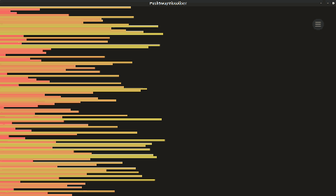
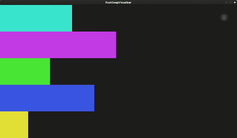
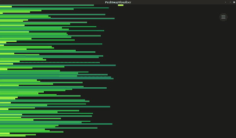
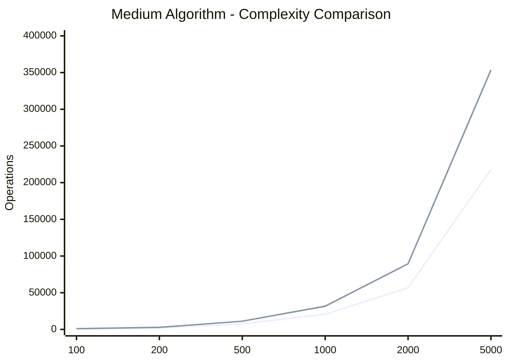
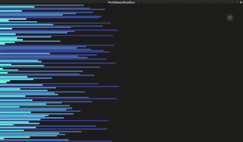

*This project has been created as part of the 42 curriculum by yakong.*

# push_swap

## Description

`push_swap` is a sorting algorithm project from the 42 curriculum. The goal is to sort a list of integers in ascending order using two stacks and a limited set of predefined operations.

Unlike traditional sorting algorithms that directly rearrange elements in an array, `push_swap` generates a sequence of instructions that transforms the initial stack into a sorted stack. The objective is to sort the input while minimizing the number of operations.

The program uses two stacks:

- **Stack A**: Contains the initial sequence of integers to be sorted.
- **Stack B**: An auxiliary stack used during the sorting process.

The program outputs the instructions required to sort Stack A in ascending order. Each instruction is printed on a separate line.

### Objectives

- Sort integers using only the operations allowed by the project.
- Implement different sorting strategies depending on the input size.
- Optimize the number of operations generated.
- Handle invalid input and edge cases safely.
- Follow the 42 Norm and write clean, readable, and maintainable C code.

### Allowed Operations

The program uses the operations defined by the push_swap subject.

| Operation | Description |
|---|---|
| `sa` | Swaps the first two elements of Stack A. |
| `sb` | Swaps the first two elements of Stack B. |
| `ss` | Swaps the first two elements of both stacks. |
| `pa` | Pushes the top element of Stack B onto Stack A. |
| `pb` | Pushes the top element of Stack A onto Stack B. |
| `ra` | Rotates Stack A upward. The first element becomes the last. |
| `rb` | Rotates Stack B upward. The first element becomes the last. |
| `rr` | Rotates both stacks upward. |
| `rra` | Reverse-rotates Stack A. The last element becomes the first. |
| `rrb` | Reverse-rotates Stack B. The last element becomes the first. |
| `rrr` | Reverse-rotates both stacks. |

### Example

```bash
./push_swap 4 3 1 2
```
Possible output:

```bash
pb
pb
pb
pb
pa
pa
pa
pa
```

The output above illustrates the format of the instructions. The actual sequence depends on the implemented algorithm and the input. Executing the generated instructions must leave Stack A sorted in ascending order.

## Instructions

### Compilation

Run the following commands from the root directory of the repository.

- `make`: Compiles the source files and creates the push_swap executable.
- `make clean`: Removes the object files.
- `make fclean`: Removes the object files and the compiled executable.
- `make re`: Cleans and rebuilds the project.

Compile the project:

```bash
make
```
## Execution

The program accepts integers as command-line arguments.

```bash
./push_swap 4 3 1 2
```
Depending on the input disorder, the program selects an appropriate sorting strategy.

For example:

```bash
./push_swap 3 2 1
./push_swap 8 5 2 7 1 6 4 3
./push_swap -5 3 -1 0 2
```

To count the number of generated operations:

```bash
./push_swap 5 2 8 1 3 | wc -l
```

If a compatible checker executable is available, the generated instructions can be validated with:

```bash
ARG="5 2 8 1 3"
./push_swap $ARG | ./checker $ARG
```

A successful result should be reported as `OK`.

## Command-Line Options

The program accepts a list of integers and optional strategy and benchmark flags.

### Strategy Selection

| Option | Description | Required Complexity |
|---|---|---|
| `--simple` | Forces the Simple sorting algorithm. | `O(n^2)` |
| `--medium` | Forces the Medium sorting algorithm. | `O(n√n)` |
| `--complex` | Forces the Complex sorting algorithm. | `O(n log n)` |
| `--adaptive` | Selects a sorting strategy based on the input disorder. | Depends on the selected strategy |

If no strategy selector is provided, the program uses the Adaptive strategy by default.

The strategy selector must work regardless of the input size or initial disorder. The implementation must therefore ensure that every strategy can safely handle all valid inputs, even when another strategy might be more efficient for that particular input.

### Benchmark Mode

The optional `--bench` flag enables benchmark reporting.

Example:

```bash
./push_swap --bench 4 3 1 2
./push_swap --simple --bench 4 3 1 2
./push_swap --bench --medium 8 5 2 7 1 6 4 3
./push_swap --complex --bench 9 7 5 3 1 8 6 4 2
./push_swap --bench --adaptive 4 3 1 2
```

## Algorithm and Data Structure

### 1. Simple Algorithm — Selection Sort Adaptation

The Simple algorithm uses a minimum extraction strategy based on selection sort, with an additional optimization for small stack sizes.

<p align="center">
  
</p>

#### Implementation

1. Small Input Optimization:

	- If Stack A contains only 2 elements, compare them and perform sa if they are out of order.
	- If Stack A contains exactly 3 elements, use the dedicated sort_three() function, which handles all possible permutations using optimized combinations of sa, ra, and rra.

	<p align="center">
  	  
	</p>

2. Minimum Extraction:

	- For inputs containing more than 3 elements, find the minimum element in Stack A using find_min_position().
	- Rotate the minimum element to the top using ra or rra, choosing the shorter direction through rotate_min_to_top().
	- Push the minimum element to Stack B using pb.
Repeat this process until exactly 3 elements remain in Stack A.

3. Final Sorting:

	- Sort the remaining 3 elements in Stack A using sort_three().
	- Push all elements back from Stack B to Stack A using pa.

#### Complexity

- Time complexity: O(n²)
- Auxiliary space complexity: O(1)
- Push_swap operations: O(n²)

This algorithm is suitable for low-disorder inputs because it provides a straightforward baseline sorting strategy.

#### Optimization Rationale

The Simple algorithm combines minimum extraction with specialized small-input sorting.

Instead of continuing the general selection process until Stack A becomes empty, the algorithm stops extracting elements when only 3 remain. These elements are sorted directly using a dedicated function.

This optimization provides two benefits:

- **Reduced operations:** Sorting the final 3 elements directly avoids unnecessary rotations and push operations between stacks.
- **Efficient small-input handling:** Inputs containing 2 or 3 elements are handled directly without entering the minimum extraction loop.

Therefore, the Simple algorithm is particularly suitable for low-disorder inputs and small datasets, providing a straightforward sorting strategy with reduced operation overhead.

### 2. Medium Algorithm — Chunk-Based Sorting

The Medium algorithm divides the normalized index range into approximately √n chunks.

<p align="center">
  
</p>

#### Implementation

1. Calculate the chunk size using ceil(√n).
2. Divide the index range into consecutive chunks.
3. Process each chunk by scanning Stack A.
4. Push elements belonging to the current chunk into Stack B.
5. Rotate smaller elements toward the bottom of Stack B.
6. Reconstruct the sorted sequence by moving elements back to Stack A.

#### Complexity

- Chunk distribution phase: O(n√n).
- Reconstruction phase: depends on the strategy used to retrieve elements.
- Auxiliary space complexity: O(1), excluding the two existing stacks.

Although the theoretical worst-case complexity is O(n²), practical benchmarks are used to evaluate whether the operation count exhibits growth closer to O(n√n).

```bash
echo "Size | Operations"

for n in 100 200 500 1000 2000 5000
do
    ARG=$(shuf -i 0-$((n-1)) -n "$n" | tr '\n' ' ')

    OPS=$(./push_swap --medium $ARG | wc -l)

    echo "$n | $OPS"
done
```
Each input size was tested 10 times using random inputs. The average operation count was compared with n√n.

| Input | Size | Average Operations |
|---|---|---|
| 100 | 830.7 | 0.831 |
| 200 | 2,065.1 | 0.730 |
| 500 | 7,628 | 0.682 |
| 1,000 | 20,758 | 0.656 |
| 2,000 | 56,854.6 | 0.636 |
| 5,000 | 218,097.5 | 0.617 |

The results suggest that the operation count follows an approximately O(n√n) growth trend for the tested inputs. However, this is an empirical observation and does not change the theoretical O(n²) worst-case complexity.



### 3. Complex Algorithm — Binary LSD Radix Sort

The Complex algorithm implements Binary Least Significant Digit (LSD) Radix Sort using normalized indexes.

<p align="center">
  
</p>

#### Implementation

1. Calculate the maximum number of bits required by the indexes.
2. Process each bit from the least significant bit to the most significant bit.
3. Push elements with a bit value of 0 from Stack A to Stack B.
4. Rotate elements with a bit value of 1 within Stack A.
5. Push all elements back from Stack B to Stack A.
6. Repeat until all bits have been processed.

#### Complexity

- Number of passes: O(log n).
- Operations per pass: O(n).
- Total time complexity: O(n log n).
- Auxiliary space complexity: O(1), excluding the two existing stacks.

This algorithm is suitable for high-disorder inputs because its complexity remains predictable regardless of the initial element order.

### 4. Custom Adaptive Algorithm

The Adaptive algorithm dynamically selects a sorting strategy based on the initial disorder of Stack A and the input size.

#### Strategy Selection

Before sorting, the algorithm calculates the initial disorder value and checks the number of elements in Stack A. Based on these values, it selects one of three internal strategies.

An additional optimization is applied for small inputs: when the number of elements is fewer than 10, the algorithm always selects Simple Sort, regardless of the disorder value. This is because Simple Sort has relatively low overhead and performs efficiently on small datasets.

For inputs containing 10 or more elements, the algorithm selects a strategy according to the following thresholds:


| Disorder | Selected Algorithm | Target Complexity |
|---|---|---|
| n ≤ 10 | Simple | O(n log n) |
| n > 10 and disorder < 0.2 | Simple | O(n²) |
| n > 10 and 0.2 ≤ disorder < 0.5 | Medium | O(n√n) |
| n > 10 and disorder ≥ 0.5 | Complex | O(n log n) |

#### Rationale

The algorithm uses three thresholds to adapt its sorting strategy to the initial arrangement of elements.

- **Small input (n < 10):** Simple Sort is always selected because its low overhead makes it efficient for small datasets, regardless of their initial disorder.
- **Low disorder (disorder < 0.2):** For larger inputs, the Simple algorithm provides a straightforward minimum-extraction strategy when the input is relatively close to sorted order.
- **Medium disorder (0.2–0.5):** The chunk-based strategy divides the elements into smaller groups to organize their movement between stacks.
- **High disorder (≥ 0.5):** Binary LSD Radix Sort is selected to provide predictable O(n log n) performance.

#### Complexity Analysis

The Adaptive algorithm selects exactly one sorting strategy after calculating the initial disorder.

Its sorting complexity therefore depends on the selected strategy:

- Low disorder: O(n²).
- Medium disorder: O(n√n).
- High disorder: O(n log n).

The auxiliary sorting space is O(1), excluding the existing stacks.

The disorder calculation overhead must also be considered separately when analyzing total C execution time.

## Error Handling and Edge Cases

The program should validate all input before starting the sorting process.

### Invalid Input

Invalid input may include:

- Non-numeric arguments.
- Malformed integers.
- Values outside the valid int range.
- Duplicate integers.
- Empty or invalid arguments, depending on the input format supported by the parser.

For invalid input, the program should print:

```bash
Error
```
The error message should be written to standard error, and no sorting instructions should be emitted.

### Edge Cases

The implementation should handle the following cases safely:

- No arguments: Exit cleanly.
- One element: No sorting operations are required.
- Already sorted input: Avoid unnecessary operations if the program checks whether the stack is already sorted.
- Reverse-sorted input: Generate a valid sequence of instructions.
- Negative integers: Sort correctly in ascending order.
- Duplicate integers: Reject the input.
- Integer boundaries: Handle INT_MIN and INT_MAX correctly.
- Memory allocation failure: Release allocated resources and exit safely.
- Empty Stack B: Avoid accessing nonexistent elements.
- Rotation boundaries: Handle rotations and reverse rotations correctly for stacks of different sizes.

## Resources

- [42 Push_swap Project Guide](https://42-cursus.gitbook.io/guide/2-rank-02/push_swap)
- [Push_swap Visualiser](https://github.com/Niimphu/push_swap_visualiser)
- [Push_swap Benchmark Tester](https://github.com/italoalmeida0/ft_ps_tester)
- [VisuAlgo – Sorting](https://visualgo.net/en)
- [DSA Visualizer – Stack & Queue](https://algolab.rajpurohit.me/)
- [Analysis of algorithms – Wikipedia](https://en.wikipedia.org/wiki/Analysis_of_algorithms)
- [15 Sorting Algorithms in 6 Minutes – YouTube](https://www.youtube.com/watch?v=kPRA0W1kECg)

### AI Usage

AI tools were used as supplementary learning and documentation resources during the development of this project.

They assisted with:

- Organizing the README according to the project requirements.
- Explaining the principles behind minimum-selection sorting and chunk-based sorting.
- Reviewing algorithm descriptions and their approximate time complexities.
- Identifying potential edge cases and possible testing scenarios.
- Improving the clarity and consistency of technical documentation.

The actual implementation, algorithm behavior, and test results must be verified against the project source code. Any AI-generated suggestions should be reviewed, understood, and adapted by the project authors.

AI assistance does not replace understanding the implementation or complying with the 42 curriculum rules.
